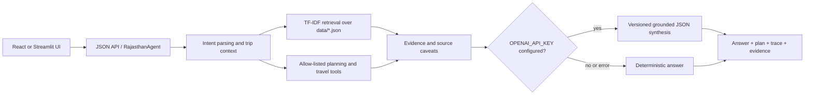

# Rajasthan Explorer AI

A Rajasthan travel planning application with a React client, JSON API, bounded agent orchestration, deterministic itinerary and budget tools, and TF-IDF retrieval over modular local knowledge. Optional OpenAI-compatible answer synthesis uses a constrained, versioned prompt and structured JSON output.

## Run the React application

Install backend dependencies once, then start the API and frontend in separate terminals:

```sh
python3 -m pip install -r requirements.txt
python3 api.py
```

```sh
cd frontend
npm install
npm run dev
```

Open the URL printed by Vite (default `http://localhost:8443`). Vite proxies `/api` to `http://127.0.0.1:8000`. The Streamlit demo remains available with `streamlit run app.py`.

## Enable model-backed synthesis

Set `OPENAI_API_KEY` in the root `.env` for grounded natural-language understanding and response synthesis. For Groq, also set `OPENAI_BASE_URL=https://api.groq.com/openai/v1` and `OPENAI_MODEL` to a model enabled in your account (for example `openai/gpt-oss-120b`). Groq requests use JSON-object mode for broad model compatibility; other providers use strict JSON Schema. The sidebar only confirms that a key was detected, not that a live model request succeeded; provider failures are logged safely in the backend terminal. This key powers the language model, not live travel inventory. Set `GOOGLE_PLACES_API_KEY` separately to discover current hotel, hostel, restaurant and activity place listings. Google Places does not provide room availability or booking prices. Without either key, the local planner and illustrative local references continue to work. Never commit `.env`.

New trips start by asking your origin city, then destination, then trip length, group size, budget and interests. Available route-table options are estimates only; live flight, train and bus schedules/fares require a separate transport provider API and are not currently connected.

The planner accepts English and Hindi city names (both Devanagari and common Romanized Hindi). Use the EN / हि switch to choose the response language. TF-IDF retrieves local, source-linked evidence; the language model reads the original request and relevant planner/evidence context to answer or narrate a plan. Retrieved passages are never used verbatim as a fallback answer. Without a model key, deterministic planning and concise localized fallbacks remain available.

## Architecture



`RajasthanAgent.max_calls` bounds deterministic tool calls. The planner computes schedules and INR budget estimates; the model handles natural-language response synthesis from the original traveler request, planner output and relevant retrieved evidence, while the local planner/tools retain control of itinerary and budget calculations.

## Trust and safety

- Budget and transport values are planning estimates, never booking quotes.
- Hotel, hostel, food and activity fixture records are illustrative until Google Places is configured. Place listings do not imply price, availability, opening status or booking access.
- Attraction, permit, access and schedule details may change; check official sources. Wildlife sightings are never guaranteed.
- Dietary labels do not establish allergen safety or Jain/vegan preparation. Confirm with the venue.
- The LLM treats the traveler message and retrieved passages as untrusted data, receives bounded context, and must return a fixed JSON shape. Provider failure falls back to deterministic output.
- API requests are limited to 4,000-character messages and 64 KiB bodies. Cross-origin requests are restricted to local dev origins unless `CORS_ORIGINS` is configured.

## Verify

```sh
python3 -m pytest -q
cd frontend && npm run build
```

Tests cover the planner, route and budget logic, RAG retrieval, tool behavior, agent follow-ups and prompt fallback.
