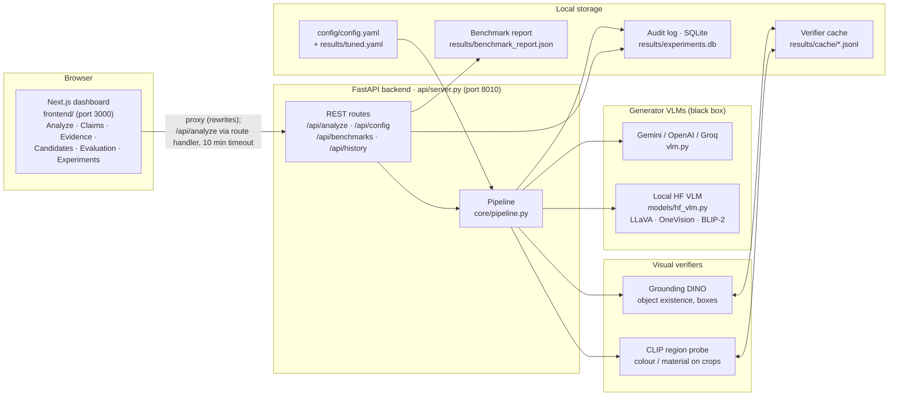
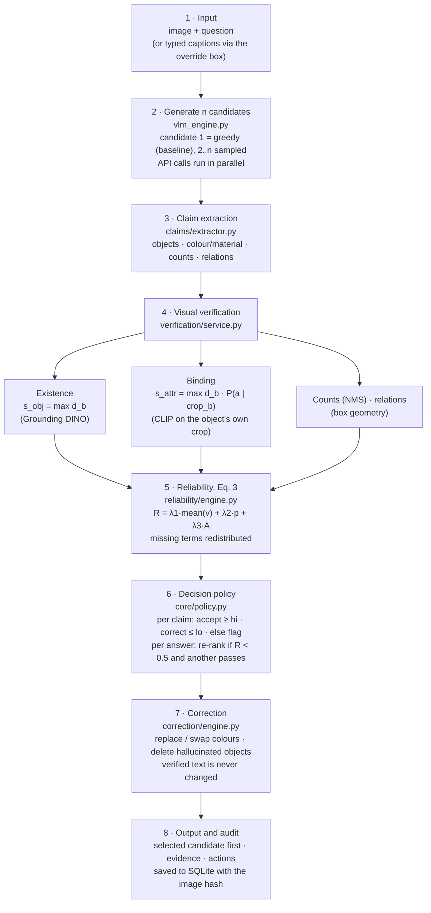
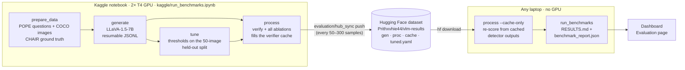

# Architecture

The VLM Reliability Toolkit is an inference-time layer that sits after any vision-language model (VLM). It turns a model's answer into checkable claims, verifies each claim against the image with separate vision models, scores the answer's reliability, and then accepts, corrects, re-ranks or abstains. No model is trained or fine-tuned.

The system has two paths:

- **Live path:** a person uses the dashboard. One image and one question go through the pipeline in seconds to minutes.
- **Benchmark path:** POPE and CHAIR run in batch on a Kaggle GPU. The results are synced through a Hugging Face dataset and reprocessed on a laptop without a GPU.

Both paths share the same pipeline code, so benchmark numbers describe the same behaviour the dashboard shows.

## 1. System overview



PNG: [images/system-overview.png](images/system-overview.png)

## 2. One analysis request, step by step



PNG: [images/analysis-pipeline.png](images/analysis-pipeline.png)

What each stage produces:

| Stage | Module | Output |
|---|---|---|
| Generate | `vlm.py`, `vlm_engine.py`, `models/hf_vlm.py` | n candidate texts. Local models also give p_j = exp(mean token log-probability). |
| Extract | `claims/extractor.py`, `claims/vocab.py` | Typed `Claim`s: object, attribute, quantity, relation. Uses the 80 COCO classes plus CHAIR synonyms. |
| Verify | `verification/service.py`, `object_verifier.py`, `attribute_verifier.py`, `grounding.py` | One `Evidence` per claim: status (SUPPORTED / CONTRADICTED / UNSUPPORTED / AMBIGUOUS), score vᵢ, boxes, crop. |
| Score | `reliability/engine.py` | Agreement A_j, claim values vᵢ, reliability R_j. |
| Decide | `core/policy.py` | Per-claim action (ACCEPT / CORRECT / ABSTAIN), selected candidate, decision and reason. |
| Correct | `correction/engine.py` | Corrected text, built by editing spans of the original sentence. |
| Record | `database/db.py` | An experiment row with the full payload. |

## 3. Reliability score in detail

For candidate *j*, with weights from `config/config.yaml` (λ₁ = 0.6, λ₂ = 0.2, λ₃ = 0.2):

```
R_j = Σ_{t ∈ available} λ_t · term_t  /  Σ_{t ∈ available} λ_t
```

| Term | Definition | Unavailable when |
|---|---|---|
| mean(vᵢ) | Average claim score. Object: s_obj. Attribute: s_attr. Count: s_obj if the count matches, else 0. Relation: min(s_subj, s_obj) if the geometry holds, else 0. | The verifier could not run (AMBIGUOUS claims are excluded) |
| p_j | Length-normalised token probability, exp((1/T)·Σ log P(token)) | API models (Gemini, typed captions) |
| A_j | Fraction of the candidate's claims also made by at least one other candidate (exact match on type, object, attribute and value) | n = 1 |

Per-claim thresholds (tuned on the held-out POPE split and stored in `results/tuned.yaml`) drive accept / correct / flag. R drives re-ranking (threshold 0.5) and whole-answer abstention.

## 4. Benchmark path (POPE and CHAIR)



PNG: [images/benchmark-pipeline.png](images/benchmark-pipeline.png)

- **Resumable:** every stage appends to JSONL and skips rows it has already done. A stopped Kaggle session resumes from the last upload.
- **Two stages:** generation (GPU, slow) is separate from processing (cheap once the verifier outputs are cached). Changing thresholds, weights or ablations then needs only `--cache-only` reprocessing, which takes seconds.
- **Ablations** (`evaluation/ablations.py`): `base_vlm`, `full_toolkit`, `no_attribute_binding`, `no_reliability_scoring`, `n_equals_1`.
- **Baseline:** candidate 1, the greedy output of the same model, with verification off.
- **Latency:** verifier time is recorded per cache entry, so the latency ratio stays the same whether a row was computed or read from the cache.

## 5. Configuration and secrets

| Where | What |
|---|---|
| `config/config.yaml` | Models, generation settings (n, temperature, tokens, seed), λ weights, per-type thresholds, verifier settings |
| `results/tuned.yaml` | Thresholds tuned on the held-out split. Merged over `config.yaml` automatically; the λ weights stay at the config values unless `--tune-weights` is used. |
| `.env` (never committed) | `GEMINI_API_KEY`, `GEMINI_MODEL`, `HF_LOCAL_MODEL` (smaller local model for CPU laptops), `RESULTS_REPO` |
| Kaggle → Add-ons → Secrets | `HF_TOKEN`, a write token used to push results to the dataset repo |

## 6. Design decisions

- **Visual evidence decides, not another LLM.** Claims are checked only with detector boxes and crop-level CLIP probabilities. No language model judges another language model.
- **Bind attributes to the object's own crop.** A blue sky can't support "blue shirt", because only the shirt's box is probed.
- **Never fabricate a term.** Missing p_j or A_j drops out of Eq. 3 instead of being guessed. Uncertain claims are flagged, not corrected.
- **Correct only with positive evidence.** A colour is replaced only when the crop clearly shows a different colour. An object is deleted only when the detector finds no box above the floor.
- **Minimal edits.** Corrections edit spans of the original sentence, so verified content is never rewritten.
- **Model-agnostic.** API models (black box) and local Hugging Face models (white box, with token probabilities) share one engine interface.
- **CPU-friendly dashboard.** On CPU-only machines Grounding DINO runs at 480×800 and local VLM inputs are reduced to a single 384 px tile; GPU runs and benchmarks use full resolution. The verifier cache keeps the two kinds of results separate.

## 7. Repository map

```text
api/server.py           FastAPI routes
core/                   schemas, config loading, pipeline, decision policy
claims/                 COCO vocabulary + CHAIR synonyms, claim extractor, claim graph
verification/           Grounding DINO, CLIP region probe, verification service, on-disk cache
reliability/engine.py   Eq. 3 and candidate agreement
correction/engine.py    evidence-driven replace / swap / delete
models/hf_vlm.py        local HF VLM engine (n-best, token probabilities)
vlm.py, vlm_engine.py   API providers and engine selection
database/db.py          SQLite audit log
evaluation/             prepare_data, generate, process, tune, chair, metrics, reports, ablations, hub_sync
jobs/run_eval.sh        benchmark runner used by the Kaggle notebook
kaggle/                 Kaggle notebook (+ .py source)
frontend/               Next.js dashboard
tests/                  unit, pipeline, API and evaluation tests (no GPU needed)
```
